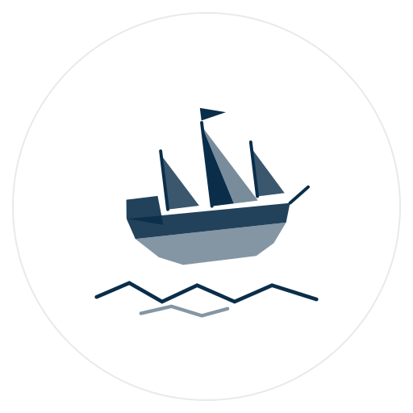

<table width="640"><tr>
<td width="130"></td>
<td>

## Patrick
**Turning ideas into innovative solutions.**

*Software engineer, Sai Gon*

I build Ruby tooling for AI agents and the people who maintain software.
Durable, boring infrastructure over clever tricks.

`Ruby` `Rails` `AI-agent tooling`
</td></tr></table>

## Projects

- [**dbwatcher**](https://github.com/patrick204nqh/dbwatcher) (Ruby) — track and visualize database changes in Rails applications.
- [**doctree**](https://github.com/patrick204nqh/doctree) (JavaScript) — Chrome extension to read a local folder as a tree: Markdown, HTML, JSON, CSV and source files.
- [**triagekit**](https://github.com/patrick204nqh/triagekit) (TypeScript) — repo triage in one self-contained HTML file. No server, no CDN.

## How to reach me

[patrick204nqh.com](https://patrick204nqh.com) / [LinkedIn](https://www.linkedin.com/in/patrick204nqh/) / [Substack](https://patrick204nqh.substack.com)